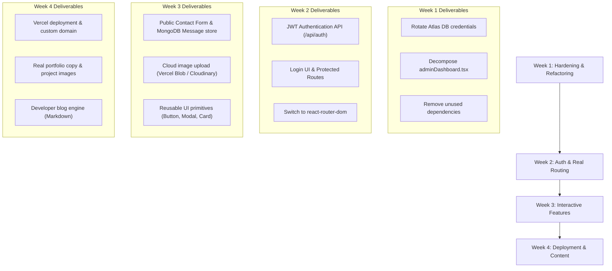

# Baraclan.me — Architecture Analysis & Scaling Strategy

> **Author**: Comprehensive Project Audit & Scaling Blueprint  
> **Target Audience**: Developer with strong HTML/CSS/JavaScript foundations learning and scaling the MERN + Tailwind + Vercel stack.  
> **Last Updated**: November 2026

---

## Table of Contents
1. [Executive Summary & Project Purpose](#1-executive-summary--project-purpose)
2. [Comprehensive Codebase Inventory (32 Files)](#2-comprehensive-codebase-inventory-32-files)
3. [Full Dependency Graph](#3-full-dependency-graph)
4. [Issues, Gaps, and Anti-Patterns Audit](#4-issues-gaps-and-anti-patterns-audit)
5. [Security Audit & Credentials Management](#5-security-audit--credentials-management)
6. [MERN + Tailwind + Vercel: Mental Models for an HTML/CSS/JS Developer](#6-mern--tailwind--vercel-mental-models-for-an-htmlcssjs-developer)
7. [Scaling Strategy: Decomposing the Admin Monolith](#7-scaling-strategy-decomposing-the-admin-monolith)
8. [Scaling Strategy: Authentication & Route Protection](#8-scaling-strategy-authentication--route-protection)
9. [Scaling Strategy: Upgrading to Real Routing](#9-scaling-strategy-upgrading-to-real-routing)
10. [Scaling Strategy: Reusable UI Design System (Tailwind)](#10-scaling-strategy-reusable-ui-design-system-tailwind)
11. [Scaling Strategy: Backend & MongoDB Scalability](#11-scaling-strategy-backend--mongodb-scalability)
12. [Vercel Deployment Architecture](#12-vercel-deployment-architecture)
13. [4-Week Action Plan & Feature Roadmap](#13-4-week-action-plan--feature-roadmap)
14. [Quick Reference: Daily Developer Commands](#14-quick-reference-daily-developer-commands)

---

## 1. Executive Summary & Project Purpose

### What the Project Aims to Do
`Baraclan.me` is a personal portfolio and lightweight headless Content Management System (CMS) designed for Vince Lawrence V. Baraclan:
1. **Public Portfolio (`/` or `/#`)**: Showcases engineering capabilities across Computer Engineering, Software, Hardware/Firmware, Data, AI, and Web development. Features category filtering, project cards with tech tags, and educational/work milestones.
2. **Admin Control Center (`/#admin`)**: A private back-office dashboard offering:
   - Complete **CRUD** for user accounts with bcrypt password encryption.
   - Complete **CRUD** for portfolio items (`Skill`, `Project`, `Experience`).
   - One-click synchronization (`Send All to MongoDB`) to push local state directly to a remote **MongoDB Atlas** database cluster.
   - Built-in Dark Mode with local storage persistence.
3. **Dual Execution Environment**:
   - **Local Development**: Node/Express API running on port `5000` with hot-reloading Vite dev server running on port `5173` (proxied via `client/vite.config.ts`).
   - **Production (Vercel)**: Serverless functions in `/api` directory executing on-demand with static SPA delivery from `client/dist`.

---

## 2. Comprehensive Codebase Inventory (32 Files)

| # | File Path | Lines | Purpose / Exports | Internal Imports | Audit Notes & Observations |
|---|---|---|---|---|---|
| 1 | `.env` | 6 | MongoDB connection string, credentials, PORT | None | Contains credentials. Must never be tracked in git. |
| 2 | `.gitignore` | 149 | Standard Node & Vite ignore rules | None | Lists `.env` and `node_modules`. |
| 3 | `package.json` | 33 | Root Node manifest: express, mongoose, bcrypt, cors, dotenv | None | Includes scripts for server, client, build. |
| 4 | `server.js` | 89 | Express local dev server, health check, admin user seeder | `api/db`, `api/models`, `api/users`, `api/portfolio` | Runs on port 5000; delegates requests to serverless-compatible handlers. |
| 5 | `vercel.json` | 17 | Vercel deployment instructions & route rewrites | None | Maps `/api/(.*)` to serverless functions and `/(.*)` to `/index.html`. |
| 6 | `api/db.js` | 44 | Exports `connectToDatabase()` with connection caching | `mongoose`, `dotenv` | Essential for Vercel serverless containers to reuse connection pools. |
| 7 | `api/models.js` | 54 | Exports Mongoose models: `User`, `Skill`, `Experience`, `Project` | `mongoose` | Uses `mongoose.models.X || mongoose.model('X', ...)` to prevent recompilation errors in serverless environments. |
| 8 | `api/users.js` | 98 | Serverless handler for `/api/users` (GET, POST, PUT, DELETE) | `api/db`, `api/models`, `bcrypt` | Has CORS headers; hashes passwords on create/update; excludes passwords from GET responses. |
| 9 | `api/portfolio.js` | 194 | Serverless handler for `/api/portfolio` CRUD + syncAll + seed | `api/db`, `api/models` | Supports single item CRUD and bulk sync (`syncAll`). |
| 10 | `client/package.json` | 34 | Client dependencies (React 19, Tailwind 4, react-router-dom) | None | Has `@supabase/supabase-js` (unused). `react-router-dom` is installed. |
| 11 | `client/vite.config.ts` | 17 | Vite bundler config with React plugin, Tailwind v4, & API proxy | None | Configures `/api` proxy to `http://localhost:5000`. |
| 12 | `client/tsconfig.json` | 7 | TypeScript project references | None | Clean configuration. |
| 13 | `client/tsconfig.app.json` | 26 | TypeScript client compiler options | None | Strict typechecking enabled. |
| 14 | `client/tsconfig.node.json` | 23 | TypeScript config for Vite configuration files | None | Clean configuration. |
| 15 | `client/index.html` | 13 | HTML5 SPA mounting shell | `src/main.tsx` | Entry point for Vite. |
| 16 | `client/src/main.tsx` | 10 | React 19 root mounting file | `index.css`, `App.tsx` | Renders `<App />` inside React `StrictMode`. |
| 17 | `client/src/App.tsx` | 84 | Root application component; hash-based router; dark mode controller | `routesPortfolio`, `routesAdmin` | Toggles `.dark` class on `document.documentElement` and persists theme. |
| 18 | `client/src/App.css` | 184 | Legacy boilerplate styles from default Vite template | None | Dead code from initial template. Safe to remove. |
| 19 | `client/src/index.css` | 114 | Core stylesheet with `@import "tailwindcss";` & `@variant dark` | None | Defines Tailwind v4 styling and root CSS custom properties. |
| 20 | `client/src/dataTypes/dataTypesPortfolio.tsx` | 32 | TypeScript interfaces: `Skill`, `Experience`, `Project`, `PortfolioData` | None | Pure TypeScript types (can be renamed to `.ts`). |
| 21 | `client/src/dataTypes/dataTypeUser.tsx` | 10 | TypeScript interface: `User` | None | Pure TypeScript types (can be renamed to `.ts`). |
| 22 | `client/src/api/users/user.tsx` | 169 | Client user API service with offline fallback | `dataTypes/dataTypeUser` | Full CRUD client functions + `localStorage` fallback. |
| 23 | `client/src/api/portfolio/apiPortfolio.tsx` | 336 | Client portfolio API service with offline fallback | `dataTypes/dataTypesPortfolio`, `portfolioData` | Full CRUD client functions + `syncPortfolioToMongo()`. |
| 24 | `client/src/api/routes/routesAdmin.tsx` | 22 | Wrapper view for `AdminDashboard` | `features/admin/adminDashboard` | Handles admin route view rendering. |
| 25 | `client/src/api/routes/routesPortfolio.tsx` | 22 | Wrapper view for `Portfolio` | `features/portfolio/portfolio` | Handles public portfolio view rendering. |
| 26 | `client/src/features/admin/adminDashboard.tsx` | 1473 | Admin Dashboard (Accounts, Skills, Projects, Experience, Atlas Sync) | Multiple | Full-featured control center; candidate for modular decomposition. |
| 27 | `client/src/features/portfolio/portfolio.tsx` | 144 | Main public portfolio page | Multiple | Responsive portfolio view with category filtering and dynamic data fetching. |
| 28 | `client/src/features/portfolio/index.ts` | 2 | Feature barrel export | `portfolio.tsx`, `dataTypesPortfolio` | Clean export interface. |
| 29 | `client/src/features/portfolio/data/portfolioData.ts` | 55 | Default static fallback data (skills, projects, experiences) | `dataTypesPortfolio` | Used as initial seed when database is unpopulated or offline. |
| 30 | `client/src/features/portfolio/components/ProjectCard.tsx` | 36 | Presentational component for single project | `dataTypesPortfolio` | Clean card with image, title, role, dates, description, tags. |
| 31 | `client/src/features/portfolio/components/SkillCard.tsx` | 28 | Presentational component for single skill | `dataTypesPortfolio` | Clean card with icon/avatar, name, category, and description. |
| 32 | `client/src/features/portfolio/components/ExperienceTable.tsx` | 32 | Presentational component for education/work list | `dataTypesPortfolio` | Clean list with type badges, dates, and organization info. |

---

## 3. Full Dependency Graph

```
server.js (Local Node Express Server)
├── api/db.js
├── api/models.js
├── api/users.js
└── api/portfolio.js

client/src/main.tsx (React DOM Mount)
└── client/src/App.tsx (Root View & Theme Manager)
    ├── api/routes/routesPortfolio.tsx
    │   └── features/portfolio/portfolio.tsx
    │       ├── dataTypes/dataTypesPortfolio.tsx
    │       ├── features/portfolio/data/portfolioData.ts
    │       ├── api/portfolio/apiPortfolio.tsx
    │       ├── api/users/user.tsx (DEFAULT_ADMIN)
    │       ├── features/portfolio/components/ProjectCard.tsx
    │       ├── features/portfolio/components/SkillCard.tsx
    │       └── features/portfolio/components/ExperienceTable.tsx
    │
    └── api/routes/routesAdmin.tsx
        └── features/admin/adminDashboard.tsx [1,473 lines]
            ├── dataTypes/dataTypeUser.tsx
            ├── dataTypes/dataTypesPortfolio.tsx
            ├── api/users/user.tsx
            └── api/portfolio/apiPortfolio.tsx
```

---

## 4. Issues, Gaps, and Anti-Patterns Audit

### 🔴 Security & Access Control
1. **Publicly Accessible Admin Dashboard**: Navigating to `/#admin` currently grants open access to the dashboard. Adding a login screen with JWT authentication is necessary before production deployment.
2. **Unauthenticated Write Endpoints**: Endpoints in `api/users.js` and `api/portfolio.js` accept mutations from any caller. Adding JWT verification middleware will restrict writes to authorized sessions.
3. **Destructive Bulk Sync**: `syncAll` in `api/portfolio.js` uses `deleteMany({})` followed by `insertMany()`. Transitioning to atomic upserts (`bulkWrite`) will protect against data loss if a network failure occurs mid-operation.

### 🟡 Architectural & Code Quality
4. **Component Monolith**: `adminDashboard.tsx` is ~1,470 lines containing all modals, tab state, search filters, and table views in a single file. Splitting it into smaller components and custom hooks will improve maintainability.
5. **Custom Hash Routing vs. React Router**: `react-router-dom` is installed in `client/package.json` but `App.tsx` currently relies on `window.location.hash`. Transitioning to `BrowserRouter` will provide standard URL paths (`/admin`, `/login`).
6. **Dead Dependencies**: `@supabase/supabase-js` is listed in `client/package.json` but unused since MongoDB Atlas handles data storage.
7. **File Extensions**: Several files containing only TypeScript interfaces or functions (`dataTypesPortfolio.tsx`, `dataTypeUser.tsx`, `user.tsx`, `apiPortfolio.tsx`) use `.tsx` instead of `.ts`.

---

## 5. Security Audit & Credentials Management

### Actions Completed:
- ✅ **Cleaned `api/db.js`**: Removed hardcoded fallback connection string containing credentials.
- ✅ **Secured Environment Loading**: Backend reads exclusively from `process.env.MONGODB_URI` and `process.env.connection_string`.

### Recommended Credentials Hygiene:
1. **Rotate MongoDB Password**:
   - Navigate to **MongoDB Atlas → Database Access**.
   - Edit user `bvincelawrence_db_user` and generate a new secure password.
   - Update your local `.env` file with the updated string.
2. **Never Commit `.env`**:
   - Verify `.env` is ignored by Git using:
     ```powershell
     git status --ignored
     ```
3. **Vercel Production Deployment**:
   - In production on Vercel, configure `MONGODB_URI` via **Project Settings → Environment Variables** instead of uploading a `.env` file.

---

## 6. MERN + Tailwind + Vercel: Mental Models for an HTML/CSS/JS Developer

### 1. Components are Modular HTML Functions
In traditional HTML, large pages are written as monolithic `.html` files. In React, pages are broken into reusable functions that return markup (JSX):
```tsx
// Instead of copy-pasting HTML for each project:
export function ProjectCard({ project }: { project: Project }) {
  return (
    <article className="rounded-xl border border-zinc-200 p-5 dark:border-zinc-800">
      <h3 className="font-bold">{project.name}</h3>
      <p>{project.description}</p>
    </article>
  );
}
```

### 2. State Replaces Manual DOM Manipulation
In vanilla JavaScript, updating the screen requires manual queries and mutations:
```javascript
// Vanilla JS:
document.querySelector('#status').innerText = 'Saved';
```
In React, you modify state variables, and React automatically updates the relevant DOM nodes:
```tsx
// React:
const [status, setStatus] = useState('Idle');
// Calling setStatus('Saved') re-renders the element automatically
```

### 3. Tailwind Replaces External CSS Files
Tailwind provides utility classes directly in markup, eliminating context-switching between HTML and CSS files:
- Vanilla CSS: `display: flex; gap: 1rem; border-radius: 0.75rem;`
- Tailwind: `flex gap-4 rounded-xl`
- Dark Mode: Prefixing any utility with `dark:` (e.g. `bg-white dark:bg-zinc-900`) applies styles when the `.dark` class is active on a parent element.

### 4. Serverless Functions Replace 24/7 Server Processes
Traditional hosting requires keeping a Node.js process running continuously (`app.listen(5000)`). On Vercel:
- Files in `/api/` act as on-demand endpoints.
- When an HTTP request arrives, Vercel executes the function, handles database queries, sends the response, and suspends execution until the next call.

---

## 7. Scaling Strategy: Decomposing the Admin Monolith

To scale `adminDashboard.tsx` cleanly, decompose the file into modular subcomponents and hooks:

```text
client/src/features/admin/
├── adminDashboard.tsx           # Main shell: header, stats, and tab switcher (~80 lines)
├── hooks/
│   ├── useUsersAdmin.ts         # User CRUD state, search filtering, handlers
│   ├── usePortfolioAdmin.ts     # Skills/Projects/Experience state and Atlas sync
│   └── useToast.ts              # Temporary alert notification manager
└── components/
    ├── AdminHeader.tsx          # Status badge, dark mode button, portfolio link
    ├── ProfileBanner.tsx        # Profile card and metrics overview
    ├── TabNavigation.tsx        # Main tab switcher
    ├── tabs/
    │   ├── UsersTab.tsx         # Account management table & search bar
    │   ├── PortfolioTab.tsx     # Skills, Projects, and Experience lists
    │   └── DatabaseTab.tsx      # Atlas connection health check & manual sync
    └── modals/
        ├── UserModal.tsx        # Create/Edit user form
        ├── SkillModal.tsx       # Create/Edit skill form
        ├── ProjectModal.tsx     # Create/Edit project form
        └── ExperienceModal.tsx  # Create/Edit experience form
```

---

## 8. Scaling Strategy: Authentication & Route Protection

### Implementation Plan:
1. **User Authentication Endpoint (`api/auth.js`)**:
   - Accepts `{ email, password }`.
   - Queries `User.findOne({ email })`.
   - Validates password using `bcrypt.compare()`.
   - Returns a signed JWT (`jsonwebtoken`):
     ```javascript
     const token = jwt.sign(
       { userId: user._id, role: user.role, email: user.email },
       process.env.JWT_SECRET,
       { expiresIn: '7d' }
     );
     ```
2. **Route Protection Middleware (`api/middleware/auth.js`)**:
   - Inspects `req.headers.authorization`.
   - Rejects unauthenticated requests with `401 Unauthorized` on write operations (`POST`, `PUT`, `DELETE`).
   - Keeps public reads (`GET /api/portfolio`) accessible to all visitors.
3. **Client Route Guard (`ProtectedRoute.tsx`)**:
   - Checks for a valid token in `localStorage`.
   - Redirects unauthenticated visitors to `/login` when trying to access `/admin`.

---

## 9. Scaling Strategy: Upgrading to Real Routing

Replace hash-based navigation with `react-router-dom`:

```tsx
// client/src/App.tsx
import { BrowserRouter, Routes, Route, Navigate } from 'react-router-dom';
import { RoutesPortfolio } from './api/routes/routesPortfolio';
import { RoutesAdmin } from './api/routes/routesAdmin';
import { LoginPage } from './features/auth/LoginPage';
import { ProtectedRoute } from './features/auth/ProtectedRoute';

export default function App() {
  return (
    <BrowserRouter>
      <Routes>
        {/* Public Portfolio */}
        <Route path="/" element={<RoutesPortfolio />} />
        
        {/* Auth Entry */}
        <Route path="/login" element={<LoginPage />} />
        
        {/* Protected Admin Control Center */}
        <Route
          path="/admin/*"
          element={
            <ProtectedRoute>
              <RoutesAdmin />
            </ProtectedRoute>
          }
        />
        
        {/* Fallback */}
        <Route path="*" element={<Navigate to="/" replace />} />
      </Routes>
    </BrowserRouter>
  );
}
```

---

## 10. Scaling Strategy: Reusable UI Design System (Tailwind)

To maintain consistent styling and reduce duplicate code, centralize common UI patterns in `client/src/components/ui/`:

- **`<Button />`**: Standardized sizing, loading spinners, and color variants (`primary`, `secondary`, `danger`, `ghost`).
- **`<Card />`**: Consistent borders, backgrounds, dark mode styles, and hover transitions.
- **`<Modal />`**: Reusable backdrop, close button, and focus-trapping wrapper.
- **`<Badge />`**: Consistent chips for skill focuses (`Web`, `Hardware`, `Software`, `AI`, `Data`).
- **`<InputField />`**: Standardized labels, error states, and dark mode borders.

---

## 11. Scaling Strategy: Backend & MongoDB Scalability

### Database Indexing (`api/models.js`)
Add query indexes to support high-performance lookups as collections grow:
```javascript
UserSchema.index({ email: 1 });
SkillSchema.index({ focus: 1 });
ProjectSchema.index({ createdAt: -1 });
ExperienceSchema.index({ type: 1, date: -1 });
```

### Safe Atomic Updates (Replacing `deleteMany`)
Transition bulk operations in `api/portfolio.js` from `deleteMany({})` to atomic upserts:
```javascript
const skillOps = skills.map(skill => ({
  updateOne: {
    filter: { skillName: skill.skillName },
    update: { $set: skill },
    upsert: true
  }
}));
await Skill.bulkWrite(skillOps);
```

### Schema Validation
Integrate a validation library such as `zod` on API endpoints to sanitize incoming payloads before writing to MongoDB.

---

## 12. Vercel Deployment Architecture

Your project is pre-configured with [`vercel.json`](file:///c:/Users/Baraclan/Documents/Projects/Baraclan.me/vercel.json):
```json
{
  "version": 2,
  "buildCommand": "npm --prefix client run build",
  "outputDirectory": "client/dist",
  "framework": "vite",
  "rewrites": [
    {
      "source": "/api/(.*)",
      "destination": "/api/$1"
    },
    {
      "source": "/(.*)",
      "destination": "/index.html"
    }
  ]
}
```

### Deployment Steps:
1. Push your repository to GitHub.
2. Import the repository into the **Vercel Dashboard**.
3. In **Project Settings → Environment Variables**, configure:
   - `MONGODB_URI`: Your production MongoDB Atlas connection string.
   - `JWT_SECRET`: A secure random string for signing auth tokens.
4. Deploy. Vercel will automatically build the React SPA and expose each file in `/api` as a serverless endpoint.

---

## 13. 4-Week Action Plan & Feature Roadmap



---

## 14. Quick Reference: Daily Developer Commands

### Running Locally
Open two terminal windows:

```powershell
# Terminal 1: Backend Express Server (Port 5000)
npm run server

# Terminal 2: Vite React Frontend (Port 5173)
npm --prefix client run dev
```

### Building & Verification
```powershell
# Run TypeScript type check and production bundle
npm --prefix client run build
```

### Testing MongoDB Connection
```powershell
node -e "require('./api/db').connectToDatabase().then(() => console.log('Connected!')).catch(console.error)"
```

### Git Workflow
```powershell
git add .
git commit -m "feat: your feature summary"
git push origin main
```

